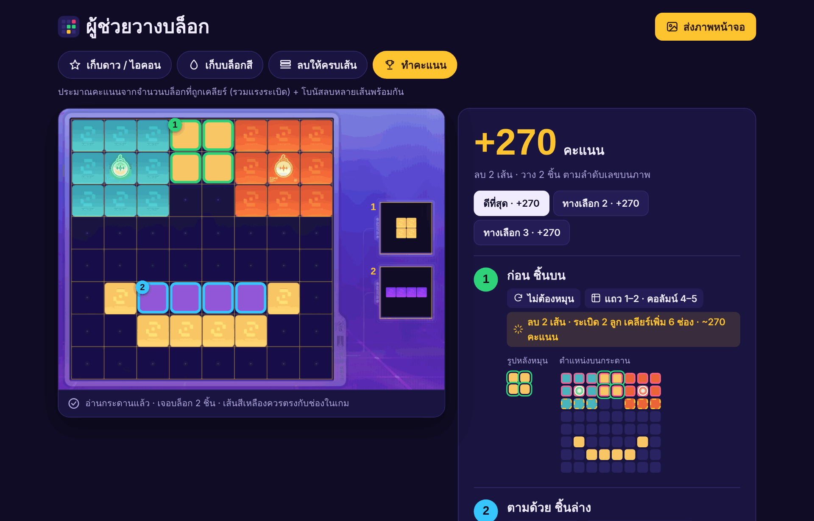
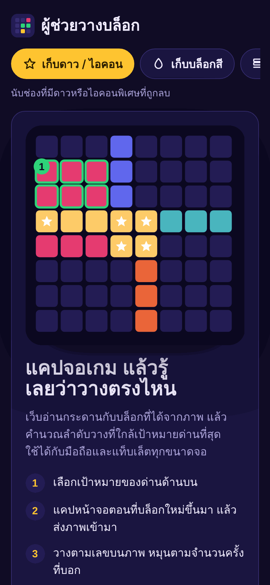
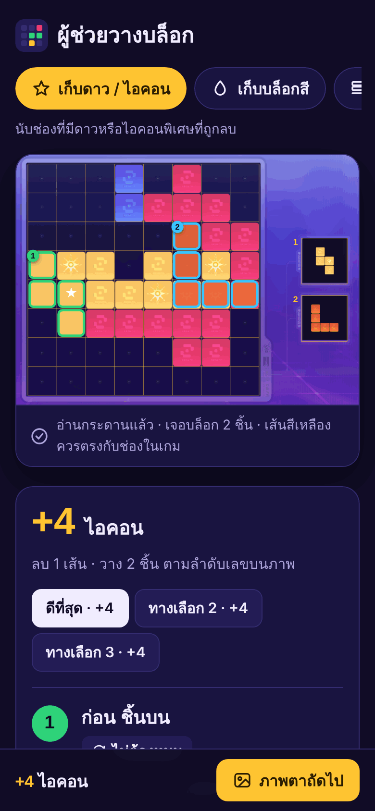

# ผู้ช่วยวางบล็อก

เว็บช่วยเล่นมินิเกม **"บล็อกลาไฮรอย"** ส่งภาพหน้าจอเกมเข้ามา เว็บจะอ่านกระดานกับบล็อกที่ได้ แล้วบอกว่าควรวางชิ้นไหนก่อน หมุนกี่ครั้ง และวางตรงไหน

**🔗 เปิดใช้งาน: https://chanasorn179.github.io/block-helper/**

<table>
  <tr>
    <td align="center"> หน้าแรก: เลือกเป้าหมายแล้วส่งภาพ</td>
    <td align="center"> ผลลัพธ์: วางตามเลขบนภาพ</td>
  </tr>
</table>

## ทำอะไรได้
- อ่านกระดาน 8×8 จากภาพหน้าจอ ทั้งสีบล็อก ดาว/ไอคอน บล็อกระเบิด และหินสีเทา
- หากระดานในภาพได้เอง ใช้ได้กับมือถือและแท็บเล็ตทุกขนาดจอ
- รองรับด่านที่ได้บล็อก 1–3 ชิ้นต่อตา
- เลือกเป้าหมายด่านได้ 4 แบบ: เก็บดาว/ไอคอน, เก็บบล็อกสี, ลบให้ครบเส้น, ทำคะแนน
- คิดผลบล็อกระเบิด (เคลียร์รอบตัว 3×3 และระเบิดต่อเนื่อง) โดยหินสีเทาหรือบล็อกข้อมูลเสียหายไม่หาย
- ลองทุกลำดับการวาง มีทางเลือกสำรองให้ และพยายามไม่ให้กระดานตัน
- ทำงานในเบราว์เซอร์ทั้งหมด ภาพไม่ถูกส่งออกไปไหน

## วิธีใช้
1. เลือกเป้าหมายของด่านด้านบน
2. แคปหน้าจอตอนที่บล็อกใหม่ขึ้นมา แล้วกด **ส่งภาพหน้าจอ**
3. วางตามเลขบนภาพ หมุนตามจำนวนครั้งที่บอก
4. ถ้าอ่านผิด เปิด **ตรวจและแก้การอ่านภาพ** แล้วแตะแก้ช่องเอง

> คะแนนในโหมด "ทำคะแนน" เป็นค่าประมาณสำหรับเทียบว่าวางแบบไหนคุ้มกว่า อาจไม่ตรงกับแต้มจริงในเกม

## เทคนิค
เว็บนี้เป็นไฟล์ `index.html` ไฟล์เดียว ไม่มี library ภายนอก
- **อ่านภาพ**: หากระดานจากร่องระหว่างช่องที่วิ่งยาวตลอดกระดาน แล้วจำแนกแต่ละช่องจากสีกับไอคอน
- **คำนวณ**: ลองทุกการหมุนและทุกตำแหน่ง ทุกลำดับชิ้น (ด่าน 3 ชิ้นใช้ beam search) ให้คะแนนตามเป้าหมายด่าน และดูว่ากระดานยังเหลือที่ว่างให้วางตาต่อไปได้ไหม
